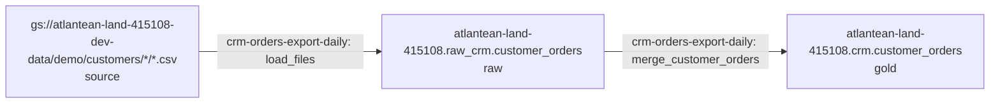

# atlantean-land-415108.crm.customer_orders

Layer: **gold**. Generated by `pa govern lineage` from the pipeline specs, lineage records and SQL in this repo; don't edit it by hand.

## Where it comes from

## Columns

| Column | Comes from | How | Step | Traced back to |
|---|---|---|---|---|
| `order_id` | (a literal or a function, no column) | `s.order_id` | crm-orders-export-daily / merge_customer_orders |  |
| `customer_id` | (a literal or a function, no column) | `s.customer_id` | crm-orders-export-daily / merge_customer_orders |  |
| `full_name` | (a literal or a function, no column) | `s.full_name` | crm-orders-export-daily / merge_customer_orders |  |
| `email` | (a literal or a function, no column) | `s.email` | crm-orders-export-daily / merge_customer_orders |  |
| `phone` | (a literal or a function, no column) | `s.phone` | crm-orders-export-daily / merge_customer_orders |  |
| `amount` | `atlantean-land-415108.raw_crm.customer_orders.amount` | `s.amount  (s.amount = SAFE_CAST(amount AS NUMERIC))` | crm-orders-export-daily / merge_customer_orders | `atlantean-land-415108.raw_crm.customer_orders.amount` |
| `_source_uri` | (a literal or a function, no column) | `s._source_uri  (s._source_uri = 'gs://atlantean-land-415108-dev-data/demo/customers/{{ ds_nodash }}/')` | crm-orders-export-daily / merge_customer_orders |  |
| `_load_id` | (a literal or a function, no column) | `'{{ run_id }}'` | crm-orders-export-daily / merge_customer_orders |  |
| `_loaded_at` | (a literal or a function, no column) | `CURRENT_TIMESTAMP()` | crm-orders-export-daily / merge_customer_orders |  |

## Row provenance

Each row here carries `_source_uri`, `_load_id`, `_loaded_at`. A person with data access can follow a row back through the layers to its source with them; the agents never read rows.
